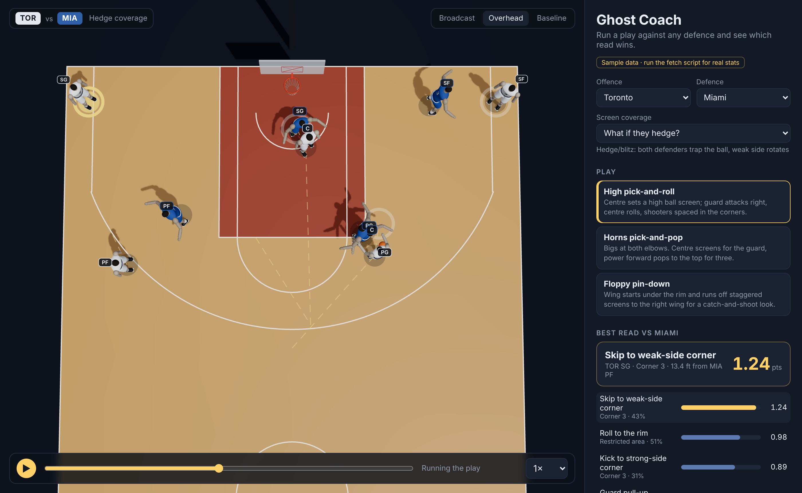
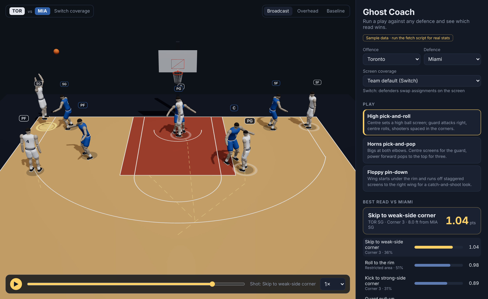

# Ghost Coach

**Run a basketball play against any defence in 3D and see which read wins.**

Pick an offence and a defence, choose a play, and watch ten jointed 3D athletes run it on a half court: sized by real height, sprinting, sliding in a defensive stance, dribbling and rising into a jump shot. The defence reacts the way that team guards ball screens (drop, switch or hedge). At the end, Ghost Coach scores every shot the play creates and highlights the best read. A ranking shows how the same play does against every other team, and a "what if they switch?" control lets a coach test a different coverage.





> **Status:** working prototype. The repo ships with **sample data** (position placeholders, synthetic numbers) so it runs anywhere. Run the data script to load real rosters and stats.

## How it works

```
 data/fetch_nba.py ──► web/src/data/teams.json ──► simulation engine ──► 3D view + rankings
 (stats.nba.com)        rosters, shot zones,        plays, defence,       React Three Fiber
                        defence by zone             expected points
```

**1. Data.** For each team, the five players with the most minutes. For each player: makes and attempts in five shot zones (restricted area, paint, mid-range, corner 3, above-the-break 3) and how much they lower opponents' FG% on the perimeter and at the rim. For each team: opponent FG% by zone. Screen coverage isn't in public data, so it lives in `data/coverages.json` for you to set.

**2. Plays.** Each play in `web/src/sim/plays.js` is a set of start spots and timed phases: who moves where, who has the ball, and where the screen happens. Current plays: high pick-and-roll, horns pick-and-pop, and a floppy pin-down.

**3. Defence.** Defenders guard their man from the rim side, sagging further the farther they are from the ball. When the screen comes, the defence's coverage takes over:

| Coverage | What the defenders do | What it tends to give up |
| --- | --- | --- |
| Drop | Big sits in the paint, guard chases over the screen | Pull-up jumpers |
| Switch | Defenders swap assignments | Mismatches (big on a guard, guard on a big) |
| Hedge | Both defenders trap the ball, weak side rotates to the roller | The weak-side corner |

**4. Outcome.** For each designed option, expected points =

```
shooter's FG% in that zone (small samples pulled toward league average)
  × how that defence allows the zone vs league average
  × contest factor from the nearest defender's distance (with a closeout on any pass)
  × that defender's rating × 2 or 3 points − a small turnover risk on passes
```

The highest is the best read. All of this is in `web/src/sim/engine.js` and covered by tests.

## Honest limits

- Players move along designed paths, and their running, sliding, dribbling and shooting motions are generated procedurally (`web/src/sim/pose.js`), not motion-captured. Figures are deliberately generic, with no real faces or likenesses. Full player-tracking data (every player's position 25 times a second) isn't public. What *is* real, once you run the fetch script, is where each player scores and how well, and how each defender and team defends.
- Coverages are inputs, not detected. A team's coverage is a setting you choose.
- The contest curve and closeout distance are modelling assumptions, tuned to look like public closest-defender splits. They're constants at the top of `engine.js` and easy to change.

## Run it

**App**

```bash
cd web
npm install
npm run dev      # http://localhost:5173
npm test
```

**Real data** (needs internet; takes a few minutes because it waits between requests)

```bash
cd data
python3 -m venv .venv && source .venv/bin/activate
pip install -r requirements.txt
python fetch_nba.py --season 2025-26 --teams TOR MIA BOS NYK CLE MIL
pytest
```

Then restart `npm run dev`. The "Sample data" badge disappears and the tags show real names.

## Project layout

```
web/src/sim/        court geometry, plays, defence, outcome model, timeline, body animation (+ tests)
web/src/components/ 3D court, jointed player rig, the animated scene
web/src/App.jsx     controls, best read, opponent ranking
data/               real-data fetch script, coverages, sample data generator (+ tests)
docs/               planning, AI-assisted development log
```

## Roadmap

- [ ] Run against real 2025-26 data and tune the model
- [ ] Draw-your-own play editor (drag players, set phases)
- [ ] Zone defence
- [ ] Late-clock and score context
- [ ] React Native viewer for the bench

---

Data comes from stats.nba.com via the open-source `nba_api` library. Independent portfolio project, not affiliated with the NBA or any team. Player figures are generic and don't depict real people.
